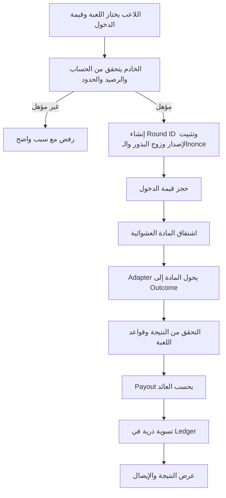
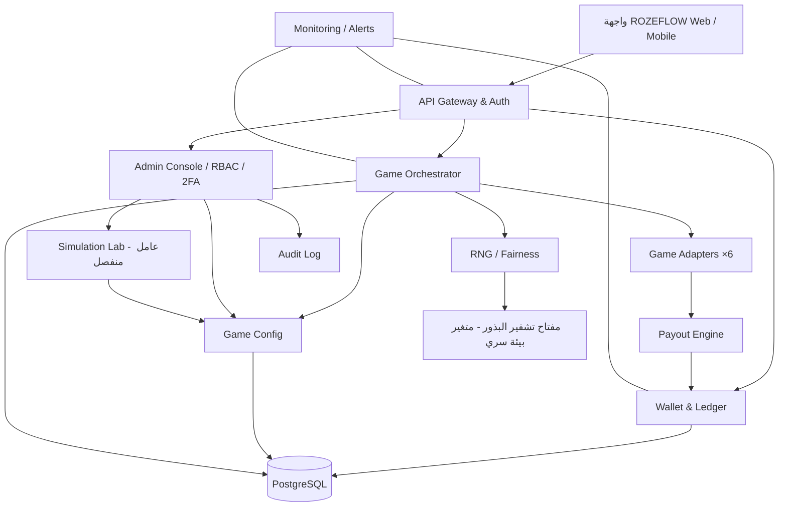

# ROZEFLOW — وثيقة المواصفات الوظيفية والتقنية وخطة التنفيذ

**الإصدار:** 1.3 (الاسم النهائي والهوية البصرية)  
**الحالة:** مسودة اعتماد قبل التنفيذ  
**نوع المنتج:** موقع ويب خاص بالدعوات، لألعاب ترفيهية برصيد افتراضي غير قابل للشراء أو التحويل أو الاسترداد  
**الجمهور:** مجموعة مغلقة من أشخاص يعرفون بعضهم، بدون نشر عام أو متاجر تطبيقات  
**عدد ألعاب الإطلاق:** 6  
**نمط التحكم:** Advanced RNG & Payout Management بإصدارات معلنة وقابلة للتدقيق  
**نظام المحفظة:** دفتر حركات Append-only + استعادة مجانية عند النفاد مع فترة انتظار  
**الاسم:** ROZEFLOW (أسماء العمل السابقة: PLAYNOVA ثم FLOWCHASH)  
**الفريق:** ward (مالك المنتج والمدير الوحيد) + Claude (التطوير والرياضيات والاختبار)

> ملخص التغييرات: **الملحق أ** (1.0 ← 1.1) و**الملحق ب** (1.1 ← 1.2) و**الملحق ج** (1.2 ← 1.3) آخر الوثيقة.

---

## 0. كيف تُقرأ هذه الوثيقة

| الكلمة | المعنى الإلزامي |
|---|---|
| **يجب** | شرط إلزامي، لا يُطلق المنتج بدونه. |
| **يُفضّل** | ممارسة موصى بها، ويُوثّق سبب تركها إن تُركت. |
| **قيمة مقترحة** | رقم بداية للمحاكاة، لا يُعتمد إلا بعد المحاكاة والموافقة (القسم 16). |
| **قرار مفتوح** | يحتاج قرار مالك المنتج (القسم 20). |

**الوحدة الحسابية:** يُعرض الرصيد للاعب بـ«النقاط»، ويُخزّن داخلياً بوحدة **السنتي‑نقطة** (1 نقطة = 100 وحدة) كعدد صحيح `BIGINT`. انظر 5.5.

---

## 1. الملخص التنفيذي

ROZEFLOW موقع ويب خاص بواجهة حديثة، يُفتح بالدعوة فقط لمجموعة من الأصدقاء والمعارف، ويضم في إصداره الأول ست ألعاب تعتمد على نتائج عشوائية أو مزيج من العشوائية واختيار/توقيت اللاعب. يدخل اللاعب كل جولة بوحدات افتراضية من محفظته، ثم تُسوّى الجولة وفق قواعد اللعبة وإصدار إعداداتها المنشور: قد يخسر قيمة الدخول، أو يحصل على عائد يُضاف إلى رصيده.

تتكون المنصة من أربعة محركات مركزية:

1. **Game Engine (Orchestrator + Adapters):** ينفذ قواعد كل لعبة ويدير حالات الجولة.
2. **RNG Engine:** يولّد مادة عشوائية آمنة قابلة للتحقق (Provably Fair).
3. **Payout Engine:** يحسب العائد وفق جدول دفع وإصدار إعدادات مثبت للجولة.
4. **Wallet & Ledger Engine:** يحجز الرصيد ويسوّي الجولة ويسجّل كل حركة بصورة غير قابلة للمحو.

ويحيط بها: لوحة إدارة، ومختبر محاكاة إحصائية، وسجل تدقيق، ومراقبة تشغيلية.

**الفكرة الاستراتيجية للتنفيذ:** لا نبني الألعاب الست دفعة واحدة. نبني المحركات الأربعة ومعها **لعبة Dice كاملة من البداية للنهاية (Vertical Slice)**، ثم نضيف بقية الألعاب واحدة تلو الأخرى بترتيب التعقيد، ونفتح الموقع للأصدقاء مبكراً بعد أول أربع ألعاب. التفاصيل في القسم 18.

**ما تغيّر بسبب طبيعة الجمهور:** لأن الجمهور مجموعة مغلقة صغيرة وليس سوقاً عاماً، أُلغيت أعمال كانت مكلفة في 1.1 (متاجر التطبيقات، المراجعة القانونية لكل سوق، اختبار الاختراق الخارجي، أهداف التوفر العالية)، وبقيت كل ضمانات العدالة والمحفظة كما هي، لأن الثقة بين الأصدقاء تعتمد عليها أكثر من أي شيء.

---

## 2. حدود المنتج ومبادئه غير القابلة للتفاوض

### 2.1 طبيعة الرصيد

- الرصيد وحدات افتراضية للعب داخل ROZEFLOW فقط.
- لا يمكن شراء الرصيد أو بيعه أو سحبه أو تحويله إلى مستخدم آخر.
- لا يمكن استبدال النقاط بنقود أو منتجات أو خدمات أو جوائز ذات قيمة.
- لا توجد مدفوعات أو إيداعات أو وسائل دفع أو محافظ مالية في المنتج.
- لا تُستخدم النقاط لمنح أفضلية خارج اللعب أو منفعة اقتصادية.
- لا تُسوّق المنصة باعتبارها وسيلة ربح أو استثمار.
- **لا توجد آلية «إهداء» أو «تحويل غير مباشر»** بين اللاعبين (مثل خسارة متعمدة في لعبة جماعية لصالح لاعب آخر). أي ميزة جماعية مستقبلية تُصمم بحيث لا تنقل نقاطاً بين الحسابات.

أي تغيير في هذه الحدود — بما في ذلك بيع النقاط أو بيع «حزم» أو اشتراك مدفوع يمنح نقاطاً — يغيّر التصنيف القانوني للمنتج في أغلب الدول، ويستلزم إيقاف العمل عليه حتى تقييم قانوني مستقل والحصول على التراخيص المطلوبة.

### 2.2 الجمهور والدعوات والامتثال

- الموقع **خاص بالدعوات فقط**: لا يوجد تسجيل مفتوح. المدير ينشئ رابط دعوة لكل شخص، صالحاً لمرة واحدة ولمدة محدودة (مثلاً 7 أيام).
- لا فهرسة في محركات البحث (`noindex`) ولا روابط عامة للموقع.
- لا نشر دولي ولا متاجر تطبيقات؛ الموقع ويب متجاوب يعمل على الجوال والحاسوب، ويمكن إضافته للشاشة الرئيسية (PWA).
- يجب أن يكون كل المدعوين بالغين (18+)، مع إقرار عمر عند قبول الدعوة.
- شروط استخدام قصيرة يوافق عليها كل مدعو، تنص على أن النقاط بلا قيمة، و**أن أي رهان بأموال حقيقية بين الأعضاء خارج الموقع على نتائج الألعاب ممنوع ويؤدي لإلغاء الحساب**. هذا مهم لأن الجمهور أصدقاء، والموقع يجب ألا يتحول إلى أداة لتسوية رهانات خارجية.
- لا يعرض الموقع أي مقارنة بين أرصدة الأعضاء بصيغة «من مدين لمن»، ولا يوفر أي وسيلة لنقل النقاط.
- **ملاحظة قانونية:** بقاء المنتج بلا مال وبدون نشر عام يخفض المخاطر القانونية كثيراً، لكن قوانين الألعاب تختلف حسب البلد. إذا تغيّر أي من هذين الشرطين يجب التوقف واستشارة مختص.

### 2.3 اللعب المسؤول

حتى مع النقاط الافتراضية، تتشابه آليات هذه الألعاب مع ألعاب المراهنة، لذلك:

- تذكير اختياري بمدة الجلسة يضبطه اللاعب.
- إمكانية «أخذ استراحة» أو إيقاف الحساب ذاتياً لفترة يحددها اللاعب.
- لا أنماط تصميم مضللة: لا «كدت أن تفوز» مصطنع، ولا مؤثرات احتفال عند خسارة صافية، ولا إشعارات تحثّ على العودة بعد خسارة.
- عرض صافي نتيجة الجلسة بوضوح، لا العوائد الإجمالية فقط.

### 2.4 عدالة النتائج

- لا تتغير فرص الفوز أو جداول الدفع بحسب هوية اللاعب أو رصيده أو خسائره أو أرباحه السابقة أو قيمة دخوله أو مدة لعبه.
- لا توجد آلية «تعويض الخاسر» أو «تقليل فرصة الفائز» بأي شكل، معلن أو سري.
- تعديلات الاحتمالات تكون على مستوى إصدار اللعبة كله، وتُعلن **قبل 72 ساعة على الأقل** (قيمة مقترحة) من دخولها حيز التنفيذ، مع سجل إصدارات عام لكل لعبة.
- لا يؤثر تعديل الإعدادات في جولة بدأت بالفعل.
- تُحفظ نسخة الإعدادات المستخدمة في كل جولة لأغراض التحقق والتدقيق.

### 2.5 الشفافية

تُعرض للاعب، قبل الجولة: قيمة الدخول، وقواعد اللعبة، وجدول العوائد والاحتمالات ذات الصلة، وRTP النظري للإصدار النشط، ورقم الإصدار، وتنبيه بأن النتائج قد تزيد الرصيد الافتراضي أو تنقصه. وتوفر المنصة صفحة «تحقق من العدالة» تمكّن اللاعب من إعادة حساب أي جولة بعد كشف البذرة (القسم 6).

---

## 3. نطاق المنتج حسب الإصدارات

| الميزة | V1 (الإطلاق للأصدقاء) | V1.x | V2 |
|---|---|---|---|
| الدخول بالدعوة، الحساب الشخصي | ✓ | | |
| الألعاب الست | ✓ (على دفعتين، القسم 18) | | |
| المحفظة الموحدة وسجل الحركات | ✓ | | |
| سجل الجولات وصفحة التحقق من العدالة | ✓ | | |
| استعادة الرصيد عند النفاد | ✓ | | |
| إحصائيات اللاعب الأساسية | ✓ | | |
| لوحة الإدارة: الدعوات، الأعضاء، إيقاف الألعاب، التقارير | ✓ | | |
| محرر الإعدادات الكامل ومختبر المحاكاة في الواجهة | أساسي | ✓ كامل | |
| إشعارات داخل الموقع | ✓ (أساسي) | | |
| واجهة عربية RTL | ✓ | إنجليزية | |
| تصنيفات موسمية بين الأصدقاء | | ✓ | |
| تحديات وإنجازات دورية | | ✓ | |
| مواسم ومسابقات | | | ✓ |
| Crash جماعي مباشر | | | ✓ |
| لعبة أصلية بهوية ROZEFLOW | | | ✓ |

**ملاحظة على التصنيفات:** في مجموعة أصدقاء، التصنيفات هي على الأرجح أكثر ميزة ستجذب الناس، لذلك جاءت أول ميزة بعد الإطلاق. تُبنى على مقاييس موسمية تُصفّر دورياً (أعلى مضاعف، إنجازات، صافي الموسم مع حد أدنى للجولات)، لا على إجمالي الرصيد، حتى لا تصبح الاستعادة طريقة للتقدم.

---

## 4. الألعاب الست

### 4.1 جدول الألعاب

| # | اللعبة | النوع | مدخلات اللاعب | نتيجة الجولة | ترتيب البناء |
|---|---|---|---|---|---|
| 1 | Dice | خطوة واحدة | قيمة دخول + حد واتجاه (أعلى/أدنى) | تحقق الشرط أو عدمه | 1 (Vertical Slice) |
| 2 | Roulette | خطوة واحدة | قيمة دخول + رهانات متعددة على أرقام/ألوان/مجموعات | خانة ناتجة وعائد كل رهان | 2 |
| 3 | Plinko | خطوة واحدة | قيمة دخول + عدد الصفوف + مستوى المخاطرة | خانة نهائية ومضاعفها | 3 |
| 4 | Mines | متعدد الخطوات | قيمة دخول + عدد الألغام + اختيارات متتابعة + تحصيل | استمرار آمن، أو لغم، أو تحصيل | 4 |
| 5 | Crash | زمن حقيقي | قيمة دخول + تحصيل يدوي أو تلقائي عند مضاعف محدد | تحصيل ناجح أو انهيار | 5 |
| 6 | Slots | خطوة واحدة، أعقد رياضياً | قيمة دخول + الخطوط المتاحة | تركيبة رموز وعائد مطابق | 6 |

**سبب الترتيب:** Dice أبسط نموذج رياضي ويختبر كل المحركات. Roulette يضيف رهانات متعددة في جولة واحدة. Plinko يضيف عشوائية متسلسلة (مسار). Mines يضيف حالة متعددة الخطوات. Crash يضيف الزمن الحقيقي وزمن الاستجابة. Slots يحتاج أطول عمل رياضي (PAR Sheet)، لذلك يبدأ تصميمه الرياضي مبكراً ويُبنى أخيراً.

### 4.2 قواعد مشتركة

- لكل لعبة قواعد منشورة قبل بدء اللعب، ورقم إصدار ظاهر.
- كل جولة لها معرّف فريد `round_id` (UUIDv7).
- تُثبّت قيمة الدخول وإصدار القواعد والإعدادات والبذرة والـnonce عند إنشاء الجولة.
- كل طلب يغيّر الرصيد يحمل `Idempotency-Key`؛ تكرار الطلب يعيد الاستجابة نفسها ولا ينفذ الحركة مرتين.
- لا يمكن تعديل الاختيارات بعد أن تصبح نهائية.
- تُعرض نتيجة الجولة وملخص حساب الرصيد (الدخول، العائد الإجمالي، الصافي) بعد التسوية.
- **جولة مفتوحة واحدة فقط لكل لاعب في الألعاب متعددة الخطوات** (Mines، Crash) في V1.
- يمكن إيقاف أي لعبة إدارياً لمنع بدء جولات جديدة؛ الجولات القائمة تُكمل وفق سياسة 9.3.

### 4.3 النموذج الرياضي لكل لعبة (جديد)

هذه المعادلات تحدد **بنية** النموذج. الأرقام المذكورة أمثلة للتوضيح، والأرقام المعتمدة تأتي من القسم 16 بعد المحاكاة. في كل الألعاب: `RTP = Σ pᵢ × mᵢ` حيث `m` معامل العائد **الإجمالي** (يشمل قيمة الدخول).

**Dice**
- فضاء النتائج: عدد صحيح موحد التوزيع `R ∈ {0, …, 9999}`، يُعرض كـ`00.00 – 99.99`.
- اللاعب يختار حداً `T` واتجاهاً. مثال «أدنى من T»: احتمال الفوز `p = T / 10000`.
- المضاعف: `m = RTP / p`، مقرّباً **للأسفل** إلى منزلتين عشريتين.
- حدود مسموحة: `p` بين 1% و95% (قيمة مقترحة) لتجنب مضاعفات متطرفة أو تافهة.
- مثال: RTP = 99%، `p = 49.50%` ← `m = 2.00`.

**Roulette**
- عجلة بـ37 خانة (0–36) بتوزيع موحد.
- RTP يتحدد من بنية العجلة لا من إعداد حر: رهان رقم واحد عائده الإجمالي 36× واحتماله 1/37، فـRTP = 36/37 ≈ **97.30%**، وهو نفسه لكل أنواع الرهانات القياسية.
- أي تعديل على RTP يتطلب تغيير بنية العجلة أو جدول الدفع كإصدار جديد معلن.
- يجب التحقق آلياً أن كل نوع رهان يعطي RTP المعلن نفسه.

**Plinko**
- لوحة بـ`n` صفوف (مثلاً 8، 12، 16). في كل صف ترتد الكرة يساراً أو يميناً باحتمال 50%.
- احتمال الخانة `k` (من `0` إلى `n`): `p_k = C(n, k) / 2ⁿ`.
- جدول المضاعفات `m_k` متماثل حول الوسط، ويُعرّف لكل تركيبة (صفوف × مستوى مخاطرة)، و`RTP = Σ p_k × m_k`.
- كل تركيبة (صفوف، مخاطرة) هي جدول مستقل يُتحقق منه ويُحاكى بشكل منفصل.

**Mines**
- لوحة بـ`N = 25` خانة، يختار اللاعب عدد الألغام `M` (1 إلى 24).
- احتمال النجاة بعد `k` اختيارات آمنة: `P(k) = C(N−M, k) / C(N, k)`.
- المضاعف الإجمالي عند التحصيل بعد `k` اختيارات: `m(k) = RTP / P(k)`، مقرباً للأسفل لمنزلتين.
- يُطبق RTP **مرة واحدة** على المضاعف التراكمي، لا عند كل خطوة (تطبيقه في كل خطوة يجعل العائد الفعلي `RTPᵏ` وهو خطأ شائع).
- لا يُسمح بالتحصيل قبل أول اختيار آمن.

**Crash**
- تُشتق قيمة موحدة `U ∈ [0, 1)` من RNG، ثم نقطة الانهيار:
  `C = max(1.00, floor(100 × RTP / (1 − U)) / 100)`
- هذه الصيغة تعطي `P(C ≥ x) ≈ RTP / x`، أي أن **أي** هدف تحصيل `x` يعطي العائد المتوقع نفسه تقريباً (RTP). تحققنا من ذلك بمحاكاة مليون جولة بـRTP = 97%: العائد الفعلي ≈ 97% عند أهداف 1.5× و2× و10×، ونسبة الانهيار الفوري (1.00×) ≈ 3.9%.
- يُحدد حد أقصى لنقطة الانهيار (مثلاً 10,000×) ويُدرج أثره في حساب RTP.
- **قرار V1:** Crash فردي (لكل لاعب جولة مستقلة) لأنه يتوافق مباشرة مع نموذج بذور اللاعب. Crash الجماعي المباشر يحتاج نموذج عدالة مختلف (سلسلة Hash عامة) ويؤجل إلى V2.

**Slots**
- بكرات بشرائط رموز (Reel Strips) محددة لكل إصدار، وجدول دفع لكل تركيبة.
- **يجب** حساب RTP بالعدّ الكامل لكل مواضع البكرات (Full Enumeration) حيث يمكن، وليس بالمحاكاة وحدها. المحاكاة تؤكد الحساب ولا تحل محله.
- يُنتج لكل إصدار «ورقة PAR» تحتوي: احتمال كل تركيبة، ومساهمتها في RTP، وتكرار الفوز (Hit Frequency)، والتذبذب.
- الميزات الإضافية (لفات مجانية، رموز جامحة) تؤجل إلى ما بعد V1 ما لم تُحسب رياضياً بالكامل.

---

## 5. المحفظة الافتراضية ودفتر الحركات

### 5.1 مكونات المحفظة الظاهرة للاعب

- **الرصيد المتاح (Available):** يمكن استخدامه لبدء جولات جديدة.
- **الرصيد المحجوز (Reserved):** قيمة دخول جولات مفتوحة لم تُسوَّ بعد.
- **إجمالي العوائد من اللعب:** مجموع العوائد الإجمالية المضافة من الجولات.
- **إجمالي قيم الدخول المستهلكة.**
- **إجمالي المنح:** منحة التسجيل + الاستعادات (منفصلة عن العوائد، حتى لا تختلط أرباح اللعب بالمنح).
- **سجل الحركات:** كل حركة بنوعها وسببها وتاريخها ومعرّف الجولة.

لا يُسمح بتعديل الرصيد مباشرة في قاعدة البيانات أو من لوحة الإدارة. كل تغيير ينتج من قيد Ledger موثق.

### 5.2 أنواع القيود في الدفتر

| النوع | الأثر على المتاح | الأثر على المحجوز | متى |
|---|---|---|---|
| `SIGNUP_GRANT` | + | 0 | عند إنشاء الحساب |
| `STAKE_RESERVE` | − | + | بدء الجولة |
| `STAKE_CONSUME` | 0 | − | تسوية الجولة (أياً كانت النتيجة) |
| `PAYOUT` | + | 0 | تسوية جولة بعائد > 0 |
| `STAKE_RELEASE` | + | − | إلغاء جولة `VOID` |
| `RECOVERY_GRANT` | + | 0 | استعادة الرصيد |
| `ADMIN_ADJUSTMENT` | ± | 0 | تعديل استثنائي بموافقة مزدوجة |
| `REVERSAL` | عكس قيد أصلي | عكس قيد أصلي | تصحيح موثق مرتبط بالقيد الأصلي |

### 5.3 دورة حياة رصيد الجولة

1. يتحقق الخادم من الرصيد المتاح ومن حدود اللعبة.
2. يحجز قيمة الدخول ذرياً (`STAKE_RESERVE`).
3. تنفذ اللعبة وتصدر النتيجة.
4. يتحقق Payout Engine من النتيجة والإعدادات المثبتة للجولة.
5. تُسوّى الجولة في معاملة واحدة: يُستهلك المبلغ المحجوز (`STAKE_CONSUME`) ويُضاف العائد الإجمالي إن وجد (`PAYOUT`). عند الإلغاء التقني يُعاد المحجوز (`STAKE_RELEASE`).
6. يُسجل كل قيد في الدفتر مع الرصيد بعده.

**مثال حسابي (مصحح):** رصيد اللاعب 1,000 نقطة، وقيمة الدخول 100 نقطة.
- بعد الحجز: المتاح 900، المحجوز 100.
- **فوز** بعائد إجمالي 196 (مضاعف 1.96×): يُستهلك المحجوز (المحجوز = 0) ويُضاف 196 إلى المتاح ← **المتاح 1,096**. الصافي **+96**.
- **خسارة**: يُستهلك المحجوز ولا يُضاف شيء ← **المتاح 900**. الصافي **−100**.
- **إلغاء تقني**: يُعاد المحجوز ← **المتاح 1,000**. الصافي **0**.

> ملاحظة التصحيح: صياغة الإصدار 1.0 «يُعاد الحجز ويُضاف العائد» تؤدي حرفياً إلى 1,196 لأن العائد الإجمالي يتضمن قيمة الدخول أصلاً. الصحيح أن الحجز **يُستهلك** ثم يُضاف العائد الإجمالي.

### 5.4 ثوابت يجب أن تتحقق دائماً (Invariants)

- `available ≥ 0` و`reserved ≥ 0` في كل لحظة.
- `reserved` = مجموع قيم الدخول للجولات في الحالات `RESERVED / RUNNING / RESOLVED`.
- `available + reserved` = مجموع كل القيود في الدفتر لهذا اللاعب.
- مجموع النقاط في النظام = المنح − (الدخول المستهلك − العوائد). يُفحص هذا آلياً كل ليلة ويطلق تنبيهاً عند أي فرق.

### 5.5 الدقة والتقريب (جديد)

- تُخزن الأرصدة والمبالغ كأعداد صحيحة بوحدة السنتي‑نقطة (`BIGINT`)، ولا يُستخدم `float` في أي حساب رصيد.
- قيم الدخول أعداد صحيحة من النقاط، والمضاعفات بمنزلتين عشريتين كحد أقصى، فيكون `stake × multiplier` دقيقاً دائماً بوحدة السنتي‑نقطة دون تقريب.
- إن احتاجت لعبة دقة أعلى، يُقرّب العائد **للأسفل** ويُدرج أثر التقريب في حساب RTP المعلن.

> **لماذا هذا مهم:** في محاكاة أجريناها على Dice باحتمال فوز 49.5% وRTP مستهدف 97%، المضاعف الصحيح 1.9596. لو خُزن الرصيد بنقاط صحيحة وقُرّب العائد للأسفل مع دخول 10 نقاط، يصبح العائد 19 بدل 19.596، وينخفض RTP الفعلي إلى **94.05%** دون أن يلاحظ أحد. لذلك القاعدة: المضاعف مقرّب لمنزلتين، والرصيد بالسنتي‑نقطة، والعائد المعلن هو الفعلي.

### 5.6 سياسة استعادة الرصيد (Recovery)

اختيار V1: «استعادة عند نفاد الرصيد»، وليس منحة يومية عامة.

- اللاعب مؤهل عندما يكون `available` أقل من **أدنى قيمة دخول في كل الألعاب النشطة**، **ولا توجد لديه جولة مفتوحة** (حتى لا يطالب بالاستعادة ورصيده محجوز في جولة قد تربح).
- لا تظهر مطالبة الاستعادة إذا كان لدى اللاعب رصيد كافٍ للعب.
- بعد الاستعادة يبدأ عداد انتظار (Cooldown) قبل السماح باستعادة أخرى؛ ويظهر للاعب الوقت المتبقي.
- الاستعادة **ترفع الرصيد إلى** قيمة الاستعادة (Top-up to) بدل إضافتها فوق البقايا، لتجنب تراكم البقايا. (قيمة مقترحة، انظر 16.)
- لا تُشترى الاستعادة ولا تُحوّل ولا تُستبدل.
- تُسجل كقيد مستقل `RECOVERY_GRANT`، وتُحمى من التكرار بقيد فريد على `(user_id, cooldown_window)` داخل معاملة ذرية.
- قيمتها وفترة انتظارها تُضبطان من لوحة الإدارة ضمن حدود قصوى، وكل تغيير يمر بدورة الموافقة (8.2).

### 5.7 قواعد منع التلاعب بالمحفظة

- دفتر الحركات Append-only على مستوى قاعدة البيانات: صلاحيات `UPDATE/DELETE` ممنوعة على حساب التطبيق نفسه.
- التصحيح بقيد `REVERSAL` مرتبط بالقيد الأصلي، لا بتعديل التاريخ.
- كل طلب يغير الرصيد يحمل `idempotency_key` بقيد فريد في قاعدة البيانات.
- تسوية الجولة والمحفظة في معاملة قاعدة بيانات واحدة (المحفظة والجولات في القاعدة نفسها في V1، فلا حاجة لـOutbox هنا).
- ترتيب الأقفال ثابت في كل الشيفرة: **الجولة ثم المحفظة**، لتجنب الجمود (Deadlock).
- أي `ADMIN_ADJUSTMENT` يتطلب سبباً مكتوباً وهوية المسؤول، ويظهر للعضو المعني في سجله (8.3). تُفعّل الموافقة الثانية إذا وُجد مدير ثانٍ.

---

## 6. محرك RNG وآلية التحقق

### 6.1 الهدف

مصدر نتائج عشوائية خادمي آمن، مستقل عن الواجهة، قابل للتدقيق، لا يمكن للاعب أو المتصفح التنبؤ به أو تعديله، **ولا يمكن للمشغّل نفسه اختيار نتيجة بعينه** بعد الالتزام.

### 6.2 متطلبات التوليد

- البذور تُولّد من مولد تشفيري آمن من نظام التشغيل (CSPRNG)، بطول 32 بايت على الأقل.
- يمنع استخدام `Math.random()` أو أي مولد غير تشفيري لإنتاج نتائج تؤثر في الرصيد.
- التحويل من البايتات إلى نطاق يتم بخوارزمية رفض (6.6) لمنع انحياز باقي القسمة.
- لا تُقبل قيمة نتيجة يرسلها العميل.
- البذور السرية تُخزن مشفرة بمفتاح سري يُحفظ في متغيرات بيئة الخادم لا في القاعدة (القسم 21)، ولا تظهر في أي سجل.

### 6.3 آلية Commit–Reveal

1. لكل لاعب «زوج بذور» نشط: `server_seed` سري جديد، و`client_seed` يختاره اللاعب أو يُولّد له ويمكنه تغييره في أي وقت.
2. يُنشر للاعب `SHA-256(server_seed)` **قبل** أي جولة تستخدم هذه البذرة.
3. لكل جولة يُستخدم `nonce` يبدأ من 0 ويزيد بواحد لكل جولة ضمن زوج البذور نفسه. لا يتكرر أبداً.
4. تُشتق مادة الجولة بـ HMAC-SHA-256 (6.5).
5. عندما يطلب اللاعب تدوير البذرة (أو يغيّر `client_seed`): يُكشف `server_seed` القديم، ويُنشأ `server_seed` جديد ويُنشر التزامه، ويبدأ `nonce` من 0.
6. يمكن للاعب أو لأي مدقق مستقل إعادة حساب كل الجولات التي استُخدمت فيها البذرة المكشوفة، والتأكد من تطابق `SHA-256` مع الالتزام المنشور مسبقاً.
7. لا يُعاد استخدام بذرة بعد كشفها. **ولا يُسمح بتدوير البذرة أثناء وجود جولة مفتوحة** (Mines/Crash)، حتى لا تُكشف مواقع الألغام قبل انتهاء الجولة.

### 6.4 ما الذي يدخل في رسالة HMAC (تصحيح مهم)

في الإصدار 1.0 كانت الرسالة تتضمن `round_id`. هذا يفتح ثغرة: الخادم يعرف `server_seed` ويولّد `round_id` بنفسه، فيستطيع نظرياً تجربة معرّفات مختلفة واختيار واحد يعطي نتيجة معينة، دون أن يكتشف اللاعب ذلك. لذلك:

- **يجب** أن تتكون الرسالة من قيم لا يتحكم بها الخادم بعد الالتزام فقط: `client_seed` و`nonce` واسم مجال اللعبة و`counter`.
- `round_id` يُخزن مرتبطاً بـ`(seed_pair_id, nonce)` في السجل، لكنه لا يدخل في الحساب.

### 6.5 شبه كود الاشتقاق (مصحح)

```text
# الترميز: كل حقل يُسبق بطوله (4 بايت big-endian) لتجنب أي التباس بين الحقول.
function encode(fields...):
    out = bytes()
    for f in fields:
        b = utf8_bytes(f) if f is string else uint64_big_endian(f)
        out += uint32_big_endian(len(b)) + b
    return out

# مجال اللعبة يمنع إعادة استخدام المادة العشوائية نفسها بين ألعاب مختلفة.
# مثال: "rozeflow:v1:dice"
function random_block(server_seed, client_seed, nonce, game_domain, counter):
    msg = encode(game_domain, client_seed, nonce, counter)
    return HMAC_SHA256(key=server_seed, message=msg)       # 32 بايت

class RandomStream(server_seed, client_seed, nonce, game_domain):
    counter = 0
    buffer = empty
    function read_bytes(n):
        while len(buffer) < n:
            buffer += random_block(server_seed, client_seed, nonce, game_domain, counter)
            counter += 1
        out = buffer[0:n]; buffer = buffer[n:]
        return out
```

### 6.6 تحويل البايتات إلى نتائج (مصحح ومكتمل)

```text
# عدد صحيح موحد في [0, upper) — خوارزمية رفض بدون انحياز
function unbiased_integer(stream, upper):
    require 1 <= upper <= 2^48
    if upper == 1: return 0
    bits  = bit_length(upper - 1)          # حساب صحيح، لا log2 عشري
    nbytes = ceil(bits / 8)
    mask  = (1 << bits) - 1
    loop:
        x = big_endian_uint(stream.read_bytes(nbytes)) AND mask
        if x < upper: return x
    # احتمال الرفض في كل محاولة أقل من 50%، والحلقة حتمية لأن المادة مشتقة من البذور.

# عدد عشري موحد في [0, 1) بدقة 52 بت — يُستخدم في Crash
function unit_float(stream):
    x = big_endian_uint(stream.read_bytes(7)) >> 4      # 52 بت
    return x / 2^52

# خلط Fisher–Yates غير منحاز — يُستخدم في Mines
function shuffle(stream, items):
    for i from len(items)-1 down to 1:
        j = unbiased_integer(stream, i + 1)
        swap(items[i], items[j])
    return items
```

**ملاحظات على تصحيح شبه الكود القديم:**
- `ceil(log2(upper))` يعتمد على حساب عشري قد يخطئ مع أعداد كبيرة؛ استبدل بـ`bit_length(upper − 1)` الصحيح دائماً.
- لم يكن ترتيب البايتات (Endianness) محدداً، ولا كيفية اشتقاق عدد عشري لـCrash، ولا خوارزمية الخلط لـMines. كلها الآن محددة، لأن أي اختلاف بسيط يجعل التحقق المستقل مستحيلاً.

### 6.7 الاشتقاق لكل لعبة

| اللعبة | المادة المطلوبة |
|---|---|
| Dice | `unbiased_integer(stream, 10000)` |
| Roulette | `unbiased_integer(stream, 37)` |
| Plinko | `n` اختيارات `unbiased_integer(stream, 2)`، واحد لكل صف |
| Mines | `shuffle(stream, [0..24])` وأول `M` عناصر هي مواقع الألغام |
| Crash | `unit_float(stream)` ثم صيغة 4.3 |
| Slots | `unbiased_integer(stream, len(strip_i))` لكل بكرة `i` |

### 6.8 قواعد إعادة المحاولة

- لا يُعاد توليد نتيجة لأنها «غير مرغوبة» أو «غير مناسبة للعرض».
- أي إعادة محاولة تقنية تستخدم نفس `(seed_pair, nonce)` فتعطي النتيجة نفسها، أو تُلغى الجولة (`VOID`) ويُعاد الحجز. ولا تتحول أبداً إلى فرصة عشوائية جديدة بعد معرفة النتيجة.
- الـnonce المستخدم في جولة ملغاة لا يُعاد استخدامه.

### 6.9 اختبارات RNG

- اختبارات وحدات للتحويلات والحالات الحدية (`upper = 1`، قوى العدد 2، أكبر قيمة مسموحة).
- **متجهات اختبار ثابتة (Test Vectors) منشورة:** بذور معروفة ← نتائج متوقعة لكل لعبة. تُستخدم في CI وفي أداة التحقق العامة.
- اختبارات توزيع إحصائي (Chi-square) على 10 ملايين عينة لكل لعبة على الأقل.
- اختبار عدم تكرار nonce تحت التزامن.
- اختبار إعادة إنتاج أي جولة من بيانات التحقق.
- اختبار مقاومة التلاعب بطلبات العميل وإعادة الطلب.
- **أداة تحقق مستقلة** (صفحة ويب + سكربت مفتوح) تُكتب بلغة أو مكتبة مختلفة عن الخادم، ويُشترط أن تعطي النتائج نفسها.
- الاختبارات الداخلية لا تُغني عن اعتماد مختبر مستقل إذا أصبح ذلك مطلوباً تنظيمياً.

---

## 7. محرك Payout

### 7.1 المصطلحات

- `stake`: قيمة الدخول المحجوزة للجولة.
- `gross_payout`: إجمالي ما يُضاف للمحفظة، ويشمل قيمة الدخول.
- `net_result = gross_payout − stake`.
- `multiplier`: معامل العائد الإجمالي.
- `RTP`: العائد النظري المتوقع كنسبة من قيم الدخول، بعد احتساب التقريب والحدود القصوى.
- `house_edge = 1 − RTP`: نسبة «استنزاف» النقاط في الاقتصاد.
- `hit_frequency`: نسبة الجولات ذات العائد > 0.
- `volatility`: الانحراف المعياري للعائد لكل وحدة دخول.

### 7.2 المعادلات

- `Σ pᵢ = 1` و `RTP = Σ pᵢ × mᵢ`
- `gross_payout = stake × multiplier` ؛ في الخسارة `gross_payout = 0` و`net_result = −stake`.
- نموذج نتيجة رابحة واحدة: `multiplier = RTP_target / p_win`.
- التذبذب: `σ = √( Σ pᵢ × mᵢ² − RTP² )`.

**مثال تعليمي:** احتمال الفوز 50% ومضاعف 1.96 ← RTP = 98%، و`σ = √(0.5 × 1.96² − 0.98²) = 0.98`.

### 7.3 الحد الأقصى للعائد وأثره على RTP

إذا وُجد حد أقصى للعائد في الجولة (`max_gross_payout`)، فإن أي نتيجة يتجاوز عائدها الحد تُقصّ، وهذا **يخفض RTP الفعلي**. لذلك:
- يُحسب RTP المعلن بعد تطبيق القص.
- يُفضّل ربط الحد الأقصى للدخول بأعلى مضاعف (`max_stake × max_multiplier ≤ max_gross_payout`) بحيث لا يحدث القص أصلاً.

### 7.4 ضوابط التسوية

- لا يُحسب العائد إلا بعد اكتمال الجولة والتحقق من نتيجتها.
- يقرأ المحرك الإعدادات المثبتة في الجولة، لا أحدث إعدادات لوحة الإدارة.
- لا تُقبل قيم سالبة أو `NaN` أو `Infinity` أو مضاعفات غير معرفة.
- الحسابات بأعداد صحيحة أو Decimal ثابتة الدقة.
- إعادة طلب التسوية تعيد **الإيصال نفسه** ولا تنشئ قيداً جديداً.
- عند خلل تقني قبل حسم الجولة: `VOID` وإعادة الحجز مع سبب موثق.

### 7.5 شبه كود التسوية (مصحح)

```text
function settle_round(round_id, verified_outcome):
    begin_database_transaction()
        round = select_round_for_update(round_id)          # القفل داخل المعاملة
        if round.status == SETTLED:
            commit(); return existing_receipt(round_id)    # تكرار آمن، لا خطأ
        assert round.status == RESOLVED

        config = load_immutable_config(round.config_version_id)
        validate_outcome_against_game_rules(verified_outcome, config)

        gross = payout_engine.calculate(round.game_id, verified_outcome, round.stake, config)
        assert is_integer(gross) and 0 <= gross <= config.max_gross_payout

        wallet = select_wallet_for_update(round.user_id)   # ترتيب الأقفال: الجولة ثم المحفظة
        insert_ledger(round.user_id, round_id, STAKE_CONSUME, round.stake, key=round_id+":consume")
        if gross > 0:
            insert_ledger(round.user_id, round_id, PAYOUT, gross, key=round_id+":payout")
        update_wallet_balances(wallet, reserved -= stake, available += gross)
        update_round(round_id, status=SETTLED, outcome=verified_outcome,
                     gross_payout=gross, net_result=gross - round.stake, settled_at=now())
    commit_database_transaction()
    return settlement_receipt(round_id)
```

**ما الذي تم تصحيحه:** في 1.0 كان قفل الجولة يتم **خارج** المعاملة (فلا يحمي شيئاً)، وكان الشرط `status in [RUNNING, RESOLVED]` يسمح بتسوية جولة لم تُحسم نتيجتها، وكان تكرار التسوية يرمي خطأ بدل إعادة الإيصال، بما يخالف 7.4 نفسه.

### 7.6 ما يتحكم به المدير

لكل إصدار لعبة:
- جدول النتائج واحتمالاتها (أو بنية اللعبة التي تحددها، مثل عدد خانات العجلة أو شرائط البكرات).
- المضاعفات لكل نتيجة.
- RTP المستهدف **كقيد للتحقق فقط** (7.8).
- حدود الدخول الدنيا والعليا، والحد الأقصى للعائد.
- قواعد التقريب.
- الخيارات المتاحة للاعب (مستويات مخاطرة Plinko، نطاق ألغام Mines، نطاق Dice).
- تاريخ بدء السريان (بعد فترة الإعلان).

**قيد عدالة أساسي:** لا يوجد إعداد احتمال خاص بلاعب أو شريحة لاعبين، ولا تعديل تلقائي وفق أي سلوك. أي «وضع صعوبة» بديل يكون خياراً يختاره اللاعب قبل الجولة، بجدول منشور مستقل.

### 7.7 التحقق الآلي قبل النشر

1. كل الاحتمالات في `[0, 1]`.
2. مجموعها = 1 (بدقة كسرية دقيقة Rational، لا عشرية تقريبية، حيث أمكن).
3. لكل نتيجة قاعدة دفع، ولا توجد نتيجة غير مغطاة.
4. RTP المحسوب (بعد التقريب والقص) يطابق المعلن ضمن ±0.01%.
5. RTP ضمن النطاق المسموح في سياسة المنصة (مثلاً 90%–99.5%).
6. الحد الأقصى للعائد ضمن حدود الحماية.
7. المحاكاة اكتملت بالحجم المطلوب، وRTP التجريبي ضمن فاصل الثقة 99% للنظري.
8. متجهات الاختبار للإصدار نجحت.
9. موافقة شخص ثانٍ مسجلة.

### 7.8 العلاقة بين RTP والاحتمالات والمضاعفات

الاحتمالات والمضاعفات **تحدد** RTP، ولا يُدخل RTP كقيمة مستقلة. إذا أدخل المدير RTP مستهدفاً لا يطابق الجدول، يرفض النظام النشر ويعرض الفرق. يمكن لأداة الإعداد **اقتراح** تعديلات مرئية على المضاعفات، يراجعها المدير ويعتمدها كإصدار جديد. ولا يغيّر النظام الاحتمالات خفية أبداً.

### 7.9 نموذج إعدادات إصدار (Dice كمثال)

```json
{
  "game_id": "dice",
  "config_version": 3,
  "status": "DRAFT",
  "ruleset_version": "1.0.0",
  "units": "centi_points",
  "stake_limits": { "min": 1000, "max": 100000 },
  "rules": {
    "outcome_space": 10000,
    "win_probability_bounds": { "min": 0.01, "max": 0.95 },
    "directions": ["under", "over"]
  },
  "payout_model": {
    "target_rtp": "0.9900",
    "multiplier_formula": "floor_2dp(target_rtp / p_win)",
    "max_gross_payout": 9900000,
    "rounding": "floor_to_centi_point"
  },
  "fairness": { "rng_algorithm_version": "1.0", "game_domain": "rozeflow:v1:dice" },
  "effective_at": null,
  "announced_at": null
}
```

لا يُسمح بتنشيط إصدار يحتوي على حقول لازمة فارغة.

---

## 8. لوحة الإدارة

### 8.1 الأقسام

1. **Overview:** اللاعبون النشطون، الجولات، تدفق النقاط، أخطاء التسوية، التنبيهات المفتوحة.
2. **Games:** تفعيل/إيقاف الألعاب، القواعد، الإصدارات، الحدود.
3. **Payout Configuration:** الجداول والاحتمالات والمضاعفات وRTP والحدود.
4. **Simulation Lab:** محاكاة ومقارنة الإصدارات (8.4).
5. **Fairness/RNG:** حالة أزواج البذور، الالتزامات، الكشف، نتائج التحقق الدوري.
6. **Wallet & Recovery:** إعدادات الاستعادة، سجل المطالبات، فحص الثوابت.
7. **Players:** الحسابات، القيود، البلاغات، الإيقاف الذاتي، سجل النشاط.
8. **Monitoring:** الأنماط غير الطبيعية، الحسابات المرتبطة، معدلات الأخطاء.
9. **Audit & Reports:** سجل تغييرات الإدارة، تقارير الاقتصاد والتوزيع.

### 8.2 دورة حياة إصدار الإعدادات (موحّدة)

`DRAFT → VALIDATED → SIMULATED → APPROVED → SCHEDULED (فترة الإعلان) → ACTIVE → RETIRED`

- حالة **اللعبة** منفصلة عن حالة **الإصدار**: `ENABLED / PAUSED / DISABLED`.
- لا تُعدّل نسخة بعد `VALIDATED`؛ أي تغيير = نسخة جديدة.
- الرجوع لنسخة سابقة = نسخة جديدة بنفس المحتوى تمر بالدورة نفسها.

**الموافقة مع مدير واحد:** في 1.1 كانت الموافقة المزدوجة إلزامية، لكن ROZEFLOW له مدير بشري واحد (ward)، ولا يصح أن يكون Claude «موافقاً ثانياً» لأنه ليس صاحب قرار في المنصة. لذلك تُستبدل الموافقة المزدوجة بثلاث ضمانات معاً:
1. **بوابات آلية لا يمكن تجاوزها:** لا يُعتمد إصدار إلا بعد نجاح كل فحوص 7.7 وحفظ تقرير المحاكاة.
2. **الإعدادات في Git:** كل إصدار إعدادات ملف في المستودع يُراجع كتغيير (Pull Request) ويُحفظ تاريخه، ثم يُحمّل للقاعدة. هذا يجعل كل تغيير مرئياً ومؤرخاً.
3. **إعلان عام للأعضاء:** صفحة «سجل التغييرات» داخل الموقع تعرض كل إصدار جديد للأعضاء قبل 72 ساعة من سريانه، مع الفرق في RTP والمضاعفات. الأعضاء أنفسهم هم الرقابة الثانية.

إذا انضم مدير ثانٍ لاحقاً، تُفعّل الموافقة المزدوجة كما في 1.1.

### 8.3 الأدوار والصلاحيات

| الدور | من | الصلاحيات |
|---|---|---|
| Owner | ward | كل شيء: الدعوات، الأعضاء، الإعدادات، إيقاف الألعاب، التعديلات الاستثنائية، التقارير |
| Player | الأصدقاء المدعوون | اللعب، المحفظة، السجل، التحقق، الإعدادات الشخصية |
| Auditor (اختياري) | عضو موثوق يختاره ward | قراءة سجل التدقيق وتقارير RTP فقط |

**إلزامي:** 2FA لحساب Owner. أي `ADMIN_ADJUSTMENT` على رصيد عضو يظهر لذلك العضو في سجله مع السبب، ولا يُخفى.

### 8.4 مختبر المحاكاة

لكل إصدار يعرض: عدد الجولات المحاكاة؛ توزيع النتائج؛ RTP النظري والتجريبي مع فاصل الثقة؛ تكرار الفوز؛ الانحراف المعياري؛ أعلى عائد؛ توزيع العوائد على شرائح؛ مقارنة بالإصدار النشط.

**إضافة: محاكاة رحلة اللاعب (Player Journey):** محاكاة لاعبين افتراضيين برصيد البداية وأنماط دخول مختلفة (دخول أدنى ثابت، دخول متوسط، نسبة من الرصيد)، وتقرير: الوسيط والمئين 10 و90 لعدد الجولات حتى النفاد، ونسبة اللاعبين الذين يصلون للاستعادة خلال أسبوع. هذا هو المقياس الذي يحدد قيم 16.

المحاكاة قابلة لإعادة الإنتاج ببذرة اختبار، ولا تستخدم أرصدة أو بيانات الإنتاج.

---

## 9. دورة حياة الجولة

### 9.1 التدفق (ألعاب الخطوة الواحدة)



### 9.2 الألعاب متعددة الخطوات (جديد)

- **Mines:** `RESERVED → RUNNING` عند إنشاء الجولة (تُشتق مواقع الألغام فوراً وتُحفظ مشفرة). كل اختيار يُسجل في `round_actions` بتسلسل. اختيار لغم ← `RESOLVED` بعائد 0. التحصيل ← `RESOLVED` بعائد `m(k)`. ثم `SETTLED`.
- **Crash (فردي، بدون WebSocket):** نقطة الانهيار `C` تُشتق عند الإنشاء ولا تُرسل للمتصفح. يسجل الخادم وقت البدء `t0` ويعيده للمتصفح مع معدل النمو، فيرسم المتصفح المنحنى محلياً بالصيغة `m(t) = floor(100 × e^(r·t)) / 100` (مثلاً `r = 0.06` في الثانية، فيصل إلى 2× بعد نحو 11.5 ثانية).
  - طلب التحصيل يُحسب بوقت **وصوله للخادم** `t_s`: إذا كان `m(t_s) < C` يُحصّل بالمضاعف `m(t_s)`، وإلا فالجولة خاسرة.
  - التحصيل التلقائي يُحدد قبل البدء: إذا كان الهدف `≤ C` فالعائد هو الهدف تماماً، بغض النظر عن الشبكة. يُعرض للعضو كخيار موصى به.
  - الجولة التي لم يُطلب تحصيلها تُحسم عند أول طلب لاحق أو بمهمة دورية بعد تجاوز وقت الانهيار.

### 9.3 الجولات المهجورة والانقطاع (جديد)

| الحالة | السياسة المقترحة |
|---|---|
| Mines بدون أي اختيار، ومرّ 24 ساعة | `VOID` وإعادة الحجز (لم تُكشف أي معلومة) |
| Mines بعد اختيار آمن واحد على الأقل، ومرّ 24 ساعة | تحصيل تلقائي بالمضاعف الحالي |
| Crash وانقطع اتصال اللاعب | يُنفذ التحصيل التلقائي إن وُجد، وإلا تكمل الجولة حتى الانهيار |
| عطل خادم قبل حسم النتيجة | `VOID` وإعادة الحجز |
| إيقاف لعبة إدارياً | لا جولات جديدة؛ الجولات المفتوحة تكمل أو تُعامل وفق الصفوف أعلاه |

### 9.4 حالات الجولة

`CREATED → RESERVED → RUNNING → RESOLVED → SETTLED`، مع `VOID` (من أي حالة قبل `SETTLED`) و`REJECTED` (قبل الحجز). لا انتقال من `SETTLED` أو `VOID`. أي تصحيح لاحق بقيد عكسي موثق.

---

## 10. المعمارية



| المكوّن | المسؤولية | لا يقوم به |
|---|---|---|
| Game Orchestrator | دورة الجولة وحالاتها | لا ينشئ أرصدة |
| RNG / Fairness | البذور، الالتزامات، الاشتقاق، الكشف | لا يعرف جدول الدفع |
| Game Adapter | تحويل المادة العشوائية إلى نتيجة | لا يلمس المحفظة |
| Payout Engine | حساب العائد من الإصدار المثبت | لا يختار نتيجة بديلة |
| Wallet/Ledger | الحجز والتسوية والاستعادة | لا يقرر من يفوز |
| Config | إصدارات القواعد ودورة الموافقة | لا يغير جولة جارية |
| Simulation Lab | المحاكاة في عامل منفصل | لا يصل إلى أرصدة الإنتاج |
| Audit | تسجيل الأحداث والتغييرات | لا يحذف شيئاً |

**القرار:** Modular Monolith في V1 بحدود وحدات صارمة (كل وحدة لها واجهة داخلية ولا تقرأ جداول غيرها مباشرة)، مع عامل خلفي منفصل للمحاكاة والمهام الدورية.

---

## 11. البيانات

| الجدول | الغرض | أهم الحقول |
|---|---|---|
| `users` | الحسابات | `id`, `email`, `status`, `birth_year_confirmed`, `locale`, `created_at` |
| `wallet_accounts` | الرصيد الحالي | `user_id`, `available`, `reserved`, `version`, `updated_at` |
| `wallet_ledger` | الدفتر (Append-only) | `id`, `user_id`, `round_id`, `type`, `amount`, `available_after`, `reserved_after`, `reverses_id`, `idempotency_key` (UNIQUE), `created_at` |
| `games` | تعريف الألعاب | `id`, `slug`, `status` |
| `game_config_versions` | الإصدارات | `id`, `game_id`, `version`, `config_json`, `config_hash`, `status`, `announced_at`, `effective_at`, `created_by`, `approved_by` |
| `seed_pairs` | أزواج البذور | `id`, `user_id`, `server_seed_enc`, `server_seed_hash`, `client_seed`, `next_nonce`, `status`, `created_at`, `revealed_at` |
| `game_rounds` | الجولات | `id`, `user_id`, `game_id`, `config_version_id`, `seed_pair_id`, `nonce`, `stake`, `player_params_json`, `status`, `outcome_json`, `gross_payout`, `net_result`, `idempotency_key` (UNIQUE), `created_at`, `settled_at` |
| `round_actions` | خطوات Mines/Crash | `round_id`, `seq`, `action`, `payload_json`, `server_time` — UNIQUE `(round_id, seq)` |
| `recovery_claims` | الاستعادات | `id`, `user_id`, `amount`, `window_start`, `claimed_at`, `next_eligible_at` — UNIQUE `(user_id, window_start)` |
| `admin_audit_logs` | تدقيق الإدارة | `id`, `admin_id`, `action`, `target`, `before_json`, `after_json`, `reason`, `ip`, `created_at` |
| `simulation_runs` | المحاكاة | `id`, `config_version_id`, `seed`, `sample_size`, `theoretical_rtp`, `observed_rtp`, `ci_low`, `ci_high`, `report_json` |
| `player_game_stats` | الإحصائيات (مُشتقة) | `user_id`, `game_id`, `rounds`, `wins`, `total_staked`, `total_returned`, `best_multiplier` |
| `notifications` | الإشعارات | `id`, `user_id`, `type`, `payload_json`, `read_at`, `created_at` |

**قيود إلزامية على مستوى القاعدة:** `UNIQUE (seed_pair_id, nonce)` في الجولات؛ `CHECK (available >= 0 AND reserved >= 0)`؛ منع `UPDATE/DELETE` على `wallet_ledger` و`admin_audit_logs` بصلاحيات القاعدة؛ تقسيم (Partitioning) شهري لجداول الجولات والدفتر عند تجاوز الحجم المتوقع.

---

## 12. واجهات API

كل الطلبات التي تغيّر حالة تحمل ترويسة `Idempotency-Key`.

### اللاعب
- `POST /api/v1/auth/*` — قبول الدعوة، الدخول، الخروج، 2FA.
- `GET /api/v1/me` / `PATCH /api/v1/me/settings` — الحساب وإعدادات اللعب المسؤول.
- `GET /api/v1/wallet` و`GET /api/v1/wallet/ledger?cursor=` — الرصيد والسجل.
- `GET /api/v1/games` و`GET /api/v1/games/{slug}/rules` — الألعاب وقواعد الإصدار النشط والقادم.
- `POST /api/v1/games/{slug}/rounds` — إنشاء جولة.
- `POST /api/v1/rounds/{id}/actions` — اختيار خانة / تحصيل.
- `GET /api/v1/rounds/{id}` و`GET /api/v1/rounds?game=&cursor=` — الجولة والسجل.
- `GET /api/v1/fairness/seeds` — الالتزام الحالي و`client_seed` والـnonce.
- `PUT /api/v1/fairness/client-seed` و`POST /api/v1/fairness/rotate` — تغيير البذرة وكشف القديمة.
- `GET /api/v1/fairness/rounds/{id}` — بيانات التحقق.
- `GET /api/v1/recovery/eligibility` و`POST /api/v1/recovery/claim`.
- `GET /api/v1/notifications`.

### الإدارة
- `GET/POST /api/v1/admin/games` و`POST /api/v1/admin/games/{id}/pause|resume`.
- `POST /api/v1/admin/game-configs` ثم `/{id}/validate`، `/simulate`، `/submit`، `/approve`، `/reject`، `/schedule`.
- `POST /api/v1/admin/simulations/player-journey`.
- `GET /api/v1/admin/players` و`POST /api/v1/admin/players/{id}/restrict`.
- `POST /api/v1/admin/adjustments` (بسبب مكتوب، ويظهر للعضو).
- `POST /api/v1/admin/invites` و`DELETE /api/v1/admin/invites/{id}` — إنشاء الدعوات وإلغاؤها.
- `GET /api/v1/admin/audit-logs` و`GET /api/v1/admin/economy-report`.

كل واجهة إدارة محمية بـRBAC و2FA، وكل واجهة تغيّر إعداداً تنتج سجل تدقيق.

---

## 13. الأمن والنزاهة والخصوصية

### 13.1 الأمن
- مصادقة آمنة، الدخول بالدعوة فقط، جلسات قصيرة للإدارة، 2FA إلزامي للمالك واختياري للأعضاء.
- تحديد معدل الطلبات لكل لاعب ولكل IP، خصوصاً على إنشاء الجولات (منع السكربتات الآلية).
- حماية OWASP Top 10 (CSRF، XSS، SQL Injection، إلخ).
- لا تُرسل أسرار RNG للمتصفح قبل الكشف؛ البذور مشفرة بمفتاح سري خارج القاعدة.
- التحقق الخادمي من توقيت Crash وتسلسل Mines.
- فصل البيئات، وإدارة أسرار مركزية، ولا بيانات إنتاج في التطوير أو المحاكاة.
- مراجعة أمنية ذاتية بقائمة OWASP Top 10 ومراجعة آلية للشيفرة قبل فتح الموقع للأعضاء.

### 13.2 مكافحة إساءة الاستخدام
- رصد الحسابات المتعددة (بصمة الجهاز، أنماط التسجيل) لأنها الطريقة الأساسية لاستغلال منح التسجيل والاستعادة والتصنيفات.
- رصد اللعب الآلي (توقيت منتظم بشكل غير بشري).
- لا يُتخذ إجراء عقابي من إشارة واحدة؛ تُجمع الإشارات وتُراجع بشرياً.

### 13.3 الخصوصية
- أقل قدر ممكن من البيانات الشخصية.
- عند حذف الحساب: تُحذف البيانات الشخصية، ويبقى الدفتر وسجل الجولات بمعرّف مجهول (Pseudonymized) لأغراض التدقيق.
- مدة احتفاظ محددة لكل نوع بيانات وموثقة في سياسة الخصوصية.

---

## 14. المتطلبات غير الوظيفية (معدّلة لمجموعة مغلقة)

| المتطلب | الهدف |
|---|---|
| حجم المستخدمين المتوقع | حتى 50 عضواً، وحتى 15 متزامنين |
| زمن استجابة إنشاء جولة (p95) | < 300 ms على الخادم |
| زمن قبول تحصيل Crash (p95) | < 150 ms على الخادم |
| التوفر | أفضل جهد (Best effort)؛ لا هدف تعاقدي |
| اختبار الضغط | 50 مستخدماً افتراضياً متزامناً يلعبون بلا توقف لمدة 10 دقائق بدون أخطاء |
| النسخ الاحتياطي | نسخة يومية تلقائية للقاعدة تُحفظ خارج المزود، واختبار استعادة مرة قبل الإطلاق ثم شهرياً |
| فقدان بيانات مقبول | ≤ 24 ساعة |
| الأجهزة | آخر إصدارين من Chrome وSafari وEdge، وشاشات من 360px |
| اللغة | العربية (RTL) في V1، والنصوص كلها في ملفات ترجمة لتسهيل إضافة الإنجليزية |
| التكلفة الشهرية المستهدفة | 0 – 30 دولاراً (القسم 21) |

---

## 15. مؤشرات اقتصاد النقاط

- إجمالي منح التسجيل، وإجمالي الاستعادات، وإجمالي الدخول، وإجمالي العوائد.
- **صافي التدفق اليومي:** المنح − (الدخول − العوائد). اقتصاد صحي = استنزاف معتدل تعوّضه الاستعادة.
- الوسيط والمئين 90 للرصيد بين اللاعبين النشطين (المتوسط وحده مضلل بسبب قلة من الأرصدة الضخمة).
- نسبة اللاعبين الذين يصلون للاستعادة أسبوعياً، وعدد الاستعادات لكل لاعب.
- RTP النظري والتجريبي لكل لعبة ولكل إصدار، مع تنبيه إذا خرج التجريبي عن فاصل الثقة.
- نسبة الإلغاءات والأخطاء وإعادة المحاولات.
- مؤشرات الاحتفاظ: D1 / D7 / D30، ومدة الجلسة.

**تنبيهات تلقائية:** فرق في فحص الثوابت (5.4) ← تنبيه حرج فوري. RTP تجريبي خارج فاصل الثقة 99.9% ← تنبيه وتحقيق. ارتفاع مفاجئ في الاستعادات أو التسجيلات ← فحص حسابات متعددة.

تُستخدم هذه المؤشرات لموازنة الاقتصاد على مستوى المنصة عبر إصدارات معلنة، لا لتغيير فرص لاعب بعينه.

---

## 16. القيم المقترحة للمحاكاة الأولى

بدلاً من ترك القيم مفتوحة بالكامل، هذه **نقطة بداية** للمحاكاة. لا يُعتمد أي رقم منها إلا بعد مختبر المحاكاة والموافقة المزدوجة.

| الإعداد | القيمة المقترحة للبدء | لماذا |
|---|---|---|
| رصيد التسجيل | 1,000 نقطة | 100 جولة بأدنى دخول |
| أدنى دخول | 10 نقاط لكل الألعاب | توحيد عتبة الاستعادة |
| أعلى دخول | 1,000 نقطة | يمنع إنهاء الرصيد في جولة واحدة بالخطأ |
| الاستعادة | رفع الرصيد إلى 500 نقطة | نصف رصيد البداية: يعيد اللاعب دون أن يلغي قيمة الحفاظ على الرصيد |
| فترة الانتظار | 12 ساعة (للاختبار مقابل 24) | تُقارن الاثنتان في محاكاة رحلة اللاعب |
| عتبة الاستعادة | أقل من 10 نقاط ولا جولة مفتوحة | لا يستطيع اللعب فعلياً |
| RTP — Dice / Plinko / Mines / Crash | 97% – 99% | جلسات أطول؛ الاستنزاف يكفي لمعنى الرصيد |
| RTP — Roulette | 97.30% (بنية 37 خانة) | تحدده بنية العجلة |
| RTP — Slots | 94% – 96% | تذبذب أعلى |
| حد العائد الأقصى للجولة | 1,000,000 نقطة، أو 10,000× للدخول، أيهما أقل | يُربط بأعلى دخول حتى لا يحدث قص (7.3) |
| مهلة الجولة المهجورة | 24 ساعة | انظر 9.3 |
| فترة الإعلان عن الإصدارات | 72 ساعة | تمنح اللاعب وقتاً لرؤية التغيير |

**نتائج محاكاة أولية أجريناها (Dice، رصيد 1,000، دخول ثابت 10، 400 لاعب افتراضي لكل سيناريو):**

| RTP | احتمال الفوز | المضاعف | وسيط الجولات حتى النفاد | المئين 10 | المئين 90 |
|---|---|---|---|---|---|
| 99% | 49.5% | 2.00× | ~6,400 | ~2,400 | ~20,900 |
| 97% | 49.5% | 1.96× | ~2,800 | ~1,300 | ~5,900 |
| 95% | 49.5% | 1.92× | ~1,800 | ~1,100 | ~3,200 |
| 97% | 10% | 9.70× | ~1,300 | ~370 | ~8,300 |

**القراءة:** حتى مع RTP منخفض نسبياً وأدنى دخول، يلعب اللاعب المتوسط آلاف الجولات قبل النفاد، فالاستعادة لن تكون حدثاً يومياً للاعب المعتدل. لكن اللاعبين الذين يرفعون قيمة الدخول سينفدون أسرع بكثير، لذلك يجب أن تحاكي «رحلة اللاعب» أنماط دخول متعددة قبل تثبيت الاستعادة وفترتها.

---

## 17. معايير القبول قبل فتح الموقع للأصدقاء

1. الدخول بالدعوة فقط يعمل: لا يمكن إنشاء حساب بدون رابط دعوة صالح، والرابط يُستخدم مرة واحدة.
2. 2FA مفعّل لحساب Owner.
3. المحفظة تعرض المتاح والمحجوز والسجل، وفحص الثوابت (5.4) يمر بلا فرق بعد مليون جولة آلية على بيئة الاختبار.
4. لا يمكن بدء جولة بدخول أكبر من المتاح أو خارج الحدود.
5. **اختبار تزامن:** 200 طلب متوازٍ بنفس `Idempotency-Key` ← قيد واحد فقط.
6. **اختبار تزامن:** طلبات تسوية متوازية لنفس الجولة ← تسوية واحدة وإيصال واحد.
7. لا توجد أي عشوائية من المتصفح في نتائج اللعب (فحص شيفرة آلي).
8. صفحة التحقق تعيد حساب 100% من عينة 10,000 جولة لكل لعبة مفعّلة بنتائج مطابقة، ومتجهات الاختبار تنجح.
9. RTP التجريبي لكل لعبة ضمن فاصل الثقة 99% للنظري على 10 ملايين جولة محاكاة.
10. لا يمكن تحميل إصدار إعدادات غير متسق (اختبارات سلبية لكل بند في 7.7).
11. الاستعادة تعمل مرة واحدة فقط ضمن فترة الانتظار حتى مع طلبات متوازية.
12. إيقاف لعبة لا يفسد أي جولة مفتوحة، والجولات المهجورة تُعالج وفق 9.3.
13. اختبار الضغط في القسم 14 ينجح.
14. مراجعة أمنية ذاتية بقائمة OWASP Top 10 ومراجعة أمنية آلية للشيفرة، بدون ثغرات حرجة أو عالية مفتوحة.
15. النسخ الاحتياطي مُجرّب: استعادة نسخة فعلية إلى قاعدة فارغة نجحت.
16. لا يوجد شراء أو سحب أو تحويل للنقاط في أي مسار، وشروط الاستخدام منشورة.

---

## 18. خطة التنفيذ لفريق من شخصين

### 18.1 تقسيم الأدوار

| ward | Claude |
|---|---|
| القرارات النهائية في المنتج والقيم | كتابة الشيفرة كاملة والاختبارات |
| إنشاء الحسابات (GitHub، Supabase، النطاق) وربطها | الرياضيات وجداول الألعاب وأوراق المحاكاة |
| مراجعة كل مرحلة وتجربتها على الجوال والحاسوب | التحقق من الثوابت واختبارات التزامن |
| اعتماد الهوية البصرية | مقترحات الهوية والتصميم |
| دعوة الأصدقاء وجمع ملاحظاتهم | تحويل الملاحظات إلى تعديلات |
| دمج التغييرات (Merge) والنشر للإنتاج | فتح Pull Request لكل مرحلة مع وصف وطريقة اختبار |

**طريقة العمل:** كل مرحلة = فرع في المستودع + Pull Request + فحوص آلية. ward يراجع ويدمج، فيُنشر الموقع تلقائياً على GitHub Pages ويجرّبه من جواله. لا شيء يصل للإنتاج بدون دمج ward.

### 18.2 المبدأ

- مسار الرياضيات يسبق البناء دائماً: لا تُبنى لعبة قبل اعتماد قواعدها وجدولها.
- **إطلاق على دفعتين:** نفتح الموقع للأصدقاء بعد أول أربع ألعاب، ونضيف Crash وSlots كتحديثات. هذا يعطي ملاحظات حقيقية مبكراً ويمنع أن تؤخر Slots (الأصعب رياضياً) كل شيء.
- إعدادات الألعاب في V1 تُكتب كملفات في Git (8.2)، فلا نحتاج محرر إعدادات كامل في الواجهة قبل الإطلاق.

### 18.3 المراحل

المدد تقديرية على افتراض أن ward يراجع 3–5 ساعات أسبوعياً. أطول ما في كل مرحلة عادة هو المراجعة والتجربة، لا كتابة الشيفرة.

| المرحلة | المدة | المخرجات | بوابة الخروج |
|---|---|---|---|
| **M0. التأسيس** | 2–4 أيام | ward ينشئ مستودع GitHub وحساب Supabase ويحجز النطاق؛ Claude ينشئ هيكل Next.js، مخطط القاعدة الأولي، CI، بيئتي اختبار وإنتاج | نشر صفحة فارغة على النطاق |
| **M1. الهوية والهيكل** | أسبوع | الهوية البصرية (القسم 23)؛ نظام التصميم RTL؛ الدعوات والدخول و2FA للمالك؛ صفحة المحفظة وسجل الحركات؛ منحة التسجيل | ward يقبل دعوة تجريبية من جواله ويرى رصيده |
| **M2. المحركات + Dice** | أسبوعان | Wallet/Ledger بالثوابت؛ RNG وCommit–Reveal؛ صفحة التحقق؛ Payout؛ Dice كاملة؛ الاستعادة؛ اختبارات التزامن | معايير القبول 3–8 و11 تنجح على Dice |
| **M3. Roulette وPlinko** | أسبوع | اللعبتان بجداولهما ومتجهات اختبارهما ومحاكاتهما | معيار 9 ينجح للعبتين |
| **M4. Mines** | أسبوع | الجولات متعددة الخطوات، `round_actions`، الجولات المهجورة | اختبارات Mines الحدية والمهجورة تنجح |
| **M5. الإدارة والإطلاق للأصدقاء** | أسبوع | لوحة الإدارة الأساسية (دعوات، أعضاء، إيقاف لعبة، تقارير الاقتصاد، سجل التدقيق)؛ صفحة سجل التغييرات؛ شروط الاستخدام؛ النسخ الاحتياطي؛ المراجعة الأمنية؛ اختبار الضغط | **كل معايير القبول 1–16 للألعاب الأربع ← فتح الموقع لأول 5–10 أصدقاء** |
| **M6. Crash** | أسبوع – أسبوعان | Crash الفردي مع التحصيل التلقائي والتوقيت الخادمي | اختبارات التوقيت والانقطاع تنجح؛ ثم إعلان للأعضاء |
| **M7. Slots** | أسبوعان | ورقة PAR بالعدّ الكامل؛ البكرات والرسوم | RTP بالعدّ الكامل = المعلن، والمحاكاة ضمن الفاصل |
| **M8. ما بعد الإطلاق** | مستمر | التصنيفات الموسمية، الإنجازات، مختبر المحاكاة الكامل في الواجهة، الإنجليزية | حسب ملاحظات الأعضاء |

**الإجمالي التقديري:** الإطلاق للأصدقاء بأربع ألعاب بعد نحو **6–7 أسابيع**، والألعاب الست كاملة بعد نحو **9–11 أسبوعاً**.

### 18.4 تعريف «منتهٍ» لكل لعبة

- القواعد والجدول معتمدان ومنشوران بنص واضح للعضو.
- Adapter مع اختبارات وحدات ومتجهات اختبار.
- صفحة التحقق تدعم اللعبة.
- اختبارات تزامن وحدود.
- محاكاة 10 ملايين جولة ضمن فاصل الثقة.
- تعمل على الجوال والحاسوب.
- الرسوم والأصوات لا توحي بفوز عند خسارة صافية.

---

## 19. سجل المخاطر

| الخطر | الاحتمال | الأثر | التخفيف |
|---|---|---|---|
| استخدام الموقع لتسوية رهانات حقيقية بين الأصدقاء خارجه | متوسط | عالٍ | نص صريح في الشروط؛ لا وسيلة نقل نقاط؛ تصنيفات موسمية لا أرصدة؛ صلاحية إلغاء الحساب |
| خطأ في التسوية أو ازدواج قيد | منخفض | عالٍ | قيود فريدة في القاعدة، فحص الثوابت الليلي، اختبارات التزامن |
| خطأ رياضي يجعل RTP الفعلي مختلفاً عن المعلن | متوسط | عالٍ (ثقة الأصدقاء) | تحقق آلي بالكسور الدقيقة، محاكاة، مراقبة RTP التجريبي |
| شك الأعضاء بأن المالك «يتحكم» بالنتائج | متوسط | عالٍ | Commit–Reveal، صفحة تحقق، سجل تغييرات عام، الإعدادات في Git، لا إعداد لكل لاعب |
| انتشار رابط الموقع خارج المجموعة | منخفض | متوسط | دعوات لمرة واحدة، `noindex`، إمكانية إيقاف الدعوات |
| تأخر شبكة يظلم لاعبي Crash | عالٍ | متوسط | التحصيل التلقائي على الخادم، عرض زمن الاستجابة |
| تسرب بذور الخادم | منخفض | عالٍ | تشفير البذور بمفتاح سري خارج القاعدة، صلاحيات محدودة |
| توقف الموقع بسبب حدود الخطط المجانية | متوسط | منخفض | مراقبة الاستخدام؛ الانتقال لخطة مدفوعة عند الحاجة (القسم 21) |
| بطء التقدم لأن المراجعة تعتمد على شخص واحد | متوسط | متوسط | مراحل صغيرة، معاينة على الجوال، قائمة اختبار قصيرة لكل PR |

---

## 20. القرارات

### محسومة (من ward، 2026-11-11)

| القرار | الاختيار |
|---|---|
| السوق | مجموعة مغلقة من أشخاص يعرفون بعضهم، بدون نشر دولي |
| المنصة | موقع ويب فقط، بدون متاجر تطبيقات |
| Crash | فردي في V1 |
| الفريق | ward + Claude |
| الهوية البصرية | هوية فرعية من ROZE (القسم 23) |
| الاسم | ROZEFLOW |
| النطاق | `rozeflow.com` |
| المزود | Supabase + GitHub Pages (القسم 21). جُرّب Vercel ثم Netlify وتعذّر التسجيل فيهما |

### ما زال مفتوحاً

1. **حجم المجموعة الأولى** التي ستُدعى بعد M5 (مقترح: 5–10 أشخاص).

---

## 21. القرار التقني

### 21.1 الاختيار وسببه

| الطبقة | الاختيار | لماذا |
|---|---|---|
| الواجهة | **Next.js + TypeScript** بتصدير ثابت (`output: export`) | لا خادم ويب نديره؛ الواجهة ملفات ثابتة فقط |
| استضافة الواجهة | **GitHub Pages** عبر GitHub Actions، مع النطاق rozeflow.com | مجاني، ولا يحتاج حساباً جديداً عند شركة استضافة (تعذّر التسجيل في Vercel وأُوقف حساب Netlify) |
| منطق الخادم | **Supabase Edge Functions** (TypeScript على Deno) | إنشاء الجولات والعشوائية والتحصيل تجري هنا، ولا شيء منها في المتصفح |
| قاعدة البيانات | **Supabase (PostgreSQL)** | Postgres حقيقي بالقيود والمعاملات التي تحتاجها المحفظة |
| المصادقة | **Supabase Auth** | يدعم الدعوة بالبريد وإيقاف التسجيل المفتوح و2FA (TOTP)، ومدمج مع القاعدة نفسها |
| منطق المحفظة والتسوية | **دوال PostgreSQL** (`SECURITY DEFINER`) تُستدعى من Edge Functions فقط | الحجز والتسوية يجريان داخل معاملة واحدة في القاعدة نفسها، فيستحيل أن ينجح نصف العملية |
| العشوائية | `node:crypto` داخل Edge Functions فقط (الوحدة نفسها `src/lib/fairness/rng.ts`) | HMAC-SHA-256 وCSPRNG أصليان بدون مكتبات إضافية |
| حماية البذور | تشفير بمفتاح سري في أسرار Edge Functions، لا في القاعدة | تسرب القاعدة وحده لا يكشف البذور |
| Crash | HTTP عادي مع توقيت الخادم، بدون WebSocket (9.2) | Crash فردي لا يحتاج بثاً لحظياً، وهذا يبسط الاستضافة كثيراً |
| الرسوم | CSS + Canvas (PixiJS لـPlinko وSlots عند الحاجة) | |
| النسخ الاحتياطي | GitHub Actions تأخذ `pg_dump` يومياً وتحفظه مشفراً | يعمل حتى على الخطة المجانية |
| المراقبة | سجلات Supabase + تنبيه من فحص الثوابت الليلي | كافٍ لهذا الحجم |

**لماذا ليس Redis أو خدمات منفصلة:** مع 50 عضواً، القاعدة نفسها تكفي للأقفال وحدود المعدل. كل مكوّن إضافي هو شيء آخر يجب صيانته.

### 21.2 التكلفة التقديرية

| البند | البداية | عند الحاجة |
|---|---|---|
| GitHub Pages | مجاني للمستودعات العامة | GitHub Pro نحو 4 دولارات شهرياً إن أردنا المستودع خاصاً |
| Supabase | خطة مجانية | Pro نحو 25 دولاراً شهرياً |
| النطاق | نحو 10–15 دولاراً سنوياً | |

**تنبيه مهم:** المشاريع على خطة Supabase المجانية تتوقف تلقائياً بعد أسبوع بلا نشاط، ولا تشمل نسخاً احتياطية تلقائية. للبناء والتجربة هذا كافٍ، والنسخ الاحتياطي اليومي عبر GitHub Actions يغطي الثانية. لكن عند فتح الموقع للأصدقاء يُفضّل الانتقال إلى Pro إذا كانت فترات الركود محتملة.

---

## 22. خلاصة الاعتماد

تثبت هذه الوثيقة مواصفات ROZEFLOW قبل التنفيذ: موقع ويب خاص بالدعوات لمجموعة أصدقاء؛ ست ألعاب بنماذج رياضية محددة؛ محرك RNG خادمي قابل للتحقق لا يمكن للمالك نفسه التلاعب بنتائجه بعد الالتزام؛ محرك Payout يُحسب فيه RTP من الاحتمالات والمضاعفات؛ محفظة بدفتر حركات وثوابت تُفحص آلياً؛ واستعادة مجانية عند النفاد. والخطة: فريق من شخصين، مراحل صغيرة بمراجعة على الجوال، وإطلاق للأصدقاء بأربع ألعاب بعد نحو 6–7 أسابيع.

**لا تُبنى أي لعبة ولا تُطلق قبل اعتماد نموذجها الرياضي ومحاكاته.** ولا تُعتمد نسب RTP أو المضاعفات بالتخمين أو بغرض تغيير فرص عضو محدد.

---

## 23. الهوية البصرية: ROZEFLOW كهوية فرعية من ROZE

المرجع: «الهوية البصرية: ورد الخطيب · ROZE» الإصدار 1.1 (`D:\LOGO`). كل القيم أدناه مأخوذة منه، وما أُضيف خصيصاً لـROZEFLOW معلَّم بـ**(جديد)**.

### 23.1 الفكرة

**ROZEFLOW = ROZE + FLOW.** ROZE هو الأصل (الوردة داخل المسنّن، الدقة الهندسية، «مختبر الليل»)، وFLOW هو ما يضيفه الموقع: الحركة المستمرة. مضاعف Crash يصعد، وكرة Plinko تنساب، والعجلة تدور. والصلة طبيعية لأن شعار ROZE نفسه مبني على الحركة: البتلات تتشكل من دوران سيرفو بخطوة 22.5°.

**الشخصية:** هندسي دقيق (الأرقام والتحقق ظاهرة)، ليلي هادئ (كحلي ولون واحد يضيء)، ودافئ (البرتقالي). **وليس صاخباً:** لا ذهب ولا أضواء كازينو ولا مؤثرات مبالغة. هذا ينسجم مع مبادئ اللعب المسؤول (2.3).

### 23.2 الشعار

- **الأيقونة:** أيقونة ROZE كما هي دون أي تعديل (يمنع الدليل تغيير ألوان البتلات أو ترتيبها أو تدويرها). في أيقونة المتصفح: `roze-icon-small.svg`.
- **الكلمة (جديد):** «ROZE» بالحروف المرسومة الأصلية (لا بخط جاهز)، تليها «FLOW» مرسومة بالهندسة نفسها: ارتفاع 100، سماكة 22، تباعد 17، والـO مربع مدوّر مثل البتلة.
  - ROZE بلون الورقي `#F4F1EA` مع ذراع الـE البرتقالية كما في الأصل.
  - FLOW بلون **سماوي الإشارة** `#3DDCFF`، فيكون «التدفق» هو العنصر الواحد المضيء.
- **النسخ المطلوبة:** الرئيسية (أيقونة + ROZEFLOW)، المختصرة للشريط العلوي، الأيقونة الصغيرة، ونسخة on-light لصفحات الشروط إن احتجناها.
- **بدون سطر فرعي ولا اسم شخصي** داخل الموقع، كقاعدة برنامج ROZE (القسم 10 من الدليل). نسخة التوقيع فقط في صفحة «عن ROZEFLOW».
- **التنفيذ:** تُضاف نسخ ROZEFLOW إلى المولّد `source/build.py` نفسه كي تبقى الهوية من مصدر واحد، وتُنسخ الملفات الناتجة إلى `public/brand/` في مشروع الموقع (لا يُشار إلى `D:\LOGO` مباشرة).

### 23.3 الألوان

الموقع يستخدم ألوان «مختبر الليل» كما هي، لأن الألعاب تُقرأ أفضل على الداكن:

| الرمز | HEX | الاستعمال في ROZEFLOW |
|---|---|---|
| `--paper` | `#06080F` | خلفية الصفحة |
| `--sheet` | `#0C1120` | بطاقات الألعاب ولوحة اللعب |
| `--smoke` | `#131A2C` | النوافذ والقوائم المرتفعة |
| `--ink` | `#EEF2F8` | النص الأساسي |
| `--ink-2` | `#AEB8CA` | النص الثانوي |
| `--ink-3` | `#8290A8` | النص الباهت |
| `--rule` / `--hair` | `#182037` / `#273250` | الفواصل والحدود |
| `--signal` | `#FF8A1F` | زر «ابدأ الجولة» وزر «حصّل»، **ونصهما كحلي `#06080F`** (لا أبيض) |
| `--signal-ink` | `#FFAE5C` | البرتقالي للنص الصغير |
| `--signal-2` | `#3DDCFF` | **المضاعف الحي** في Crash، والقيمة الأهم في كل لعبة، وFLOW في الشعار |

**ألوان دلالية (جديد):** دليل ROZE لا يحوي لوناً للربح والخسارة على الداكن، وأحمر الوردة `#D9342B` محجوز للمسنّن وحده ولا يصلح نصاً (تباين 4.3). لذلك:

| الحالة | اللون | التباين على `#06080F` | السبب |
|---|---|---|---|
| ربح صافي | أخضر `#3ECF8E` (جديد) | 10.0 ✓ | واضح ومستقل عن ألوان العلامة |
| خسارة | الباهت `#8290A8` | 6.2 ✓ | الخسارة تُعرض بهدوء لا بأحمر منبّه؛ لا دراما حول الخسارة ولا حثّ على «الاسترداد» |
| استرجاع (VOID) | `--ink-2` `#AEB8CA` | 10.0 ✓ | محايد |

**قواعد النِّسب من الدليل تبقى:** الكحلي هو المساحة؛ البرتقالي يضيء ولا يملأ (زر أو خط أو نقطة، لا خلفية قسم)؛ السماوي لعنصر واحد مهم في الشاشة؛ لا نص برتقالي أو سماوي على خلفية فاتحة.

### 23.4 الخطوط

| الدور | اللاتيني | العربي |
|---|---|---|
| العناوين | Space Grotesk | Noto Kufi Arabic |
| النص | Inter | IBM Plex Sans Arabic |
| **الأرقام: الرصيد، المضاعفات، الإيصالات، البصمات** | **JetBrains Mono** | IBM Plex Sans Arabic |

JetBrains Mono مناسب تماماً هنا: أرقامه متساوية العرض، فلا يرتجف المضاعف وهو يصعد في Crash، وتصطف الأرصدة في السجل. والخطوط محفوظة داخل الموقع (`public/fonts`) لا من Google، كما في الدليل.

**قواعد العربية من الدليل:** لا تباعد بين الحروف، لا أحرف كبيرة، الحركة كلمة كلمة.

### 23.5 الحركة

- **«تفتّح السيرفو»** هو مؤشر التحميل وشاشة البداية: `roze-icon-small-animated.svg` في الشريط العلوي، والكبيرة في شاشة الدخول.
- **(جديد)** حركة الألعاب تستعير منطق السيرفو: العجلة تتوقف بتجاوز بسيط ثم استقرار، وبطاقات Mines تنقلب بخطوة 90°، وكرة Plinko ترتد بإيقاع ثابت.
- **(جديد) لا احتفال عند خسارة صافية:** المؤثر البصري يتبع **الصافي** لا الإجمالي. ربح صافي = ومضة نواة سماوية قصيرة. خسارة = لا شيء.
- احترام «تقليل الحركة» في الجهاز: تتوقف الحركات الزخرفية، وتبقى المعلومة.

### 23.6 العناصر الرسومية

- **شبكة النقاط** (كل 22 بكسل، `#171D2C`) خلفية للوحات الألعاب.
- **زخارف الرسم الهندسي في صفحة «تحقق من العدالة»:** البذرة والـnonce والبصمة تظهر كنداءات مرقّمة (01، 02، 03) بخط JetBrains Mono، و«جدول عنوان» أسفل الإيصال كلوحة هندسية (رقم الجولة، الإصدار، التاريخ). هذا يحوّل صفحة تقنية جافة إلى أوضح شيء في هوية الموقع.
- **النقطة النابضة البرتقالية** قبل اسم اللعبة النشطة.

### 23.7 الكتابة والصوت

- العربية أولاً، وجمل قصيرة بلا مبالغة.
- أرقام حقيقية: «RTP ‏99%»، «احتمال الفوز 49.50%»، لا «فرص رائعة».
- الأشهر الشامية والساعة من 1 إلى 12 في كل التواريخ (السجل، الإيصالات، سجل التغييرات).
- لا لغة مقامرة: «جولة» و«قيمة الدخول» و«العائد»، لا «رهان» ولا «اربح الآن».

### 23.8 تنبيه على العلاقة بالعلامة الأم

ROZE هو أيضاً اسم برنامج المحاسبة الذي تبيعه لأصحاب المحلات. ربط موقع ألعاب حظ (حتى بنقاط افتراضية) باسم ROZE قد يُفهم خطأً لو انتشرت صورة منه خارج المجموعة. الموقع خاص فالخطر صغير، لكن للاحتياط: لا تظهر عبارة «by ROZE» ولا رابط لبرنامج المحاسبة داخل ROZEFLOW، وتبقى العلاقة بصرية فقط.

### 23.9 قائمة فحص الهوية لكل شاشة

- [ ] الكحلي هو المساحة، والبرتقالي لعنصر واحد يلفت النظر.
- [ ] السماوي لعنصر واحد فقط في الشاشة.
- [ ] أزرار البرتقالي بنص كحلي.
- [ ] كل الأرقام بـJetBrains Mono.
- [ ] الربح أخضر، والخسارة باهتة، ولا احتفال عند خسارة صافية.
- [ ] العربية بلا تباعد ولا أحرف كبيرة.
- [ ] التواريخ بالأشهر الشامية والساعة 1–12.

---

## الملحق أ — ما الذي تغيّر عن الإصدار 1.0

### تصحيحات أخطاء
1. **مثال المحفظة (4.2 سابقاً ← 5.3):** صياغة «يُعاد الحجز ويُضاف العائد» تعطي 1,196 لا 1,096. الصحيح: الحجز يُستهلك ثم يُضاف العائد الإجمالي.
2. **ثغرة في رسالة HMAC (5.7 سابقاً ← 6.4):** إدخال `round_id` الذي يولّده الخادم يسمح نظرياً للخادم باختيار النتيجة. أُزيل من الحساب.
3. **شبه كود التسوية (6.8 سابقاً ← 7.5):** القفل كان خارج المعاملة، والشرط كان يسمح بتسوية جولة لم تُحسم، والتكرار كان يرمي خطأ بدل إعادة الإيصال.
4. **شبه كود خوارزمية الرفض:** استبدال `ceil(log2)` العشري بـ`bit_length` الصحيح، وتحديد ترتيب البايتات وترميز الحقول.
5. **ترقيم مكرر:** قسمان برقم 5.6؛ أُعيد ترقيم الوثيقة كاملة.
6. **حالات الإصدار:** قائمتان مختلفتان (6.5 و7.2) وُحّدتا في 8.2.

### إضافات جوهرية
7. نموذج رياضي محدد لكل لعبة من الست (4.3)، بما في ذلك صيغة Crash المتحقق منها بالمحاكاة، وتحذير من خطأ تطبيق RTP في كل خطوة في Mines.
8. الدقة والتقريب بالسنتي‑نقطة (5.5)، مع مثال محاكاة يوضح كيف يخفض التقريب الخاطئ RTP من 97% إلى 94%.
9. أنواع قيود الدفتر وثوابت المحفظة التي تُفحص آلياً (5.2، 5.4).
10. اشتقاق الأعداد العشرية والخلط لكل لعبة، ومتجهات الاختبار، وأداة تحقق مستقلة (6.6–6.9).
11. الجولات متعددة الخطوات والمهجورة والانقطاع (9.2، 9.3).
12. مصفوفة الأدوار والصلاحيات، و2FA والموافقة المزدوجة إلزاميتان (8.3).
13. نطاق الإصدارات V1 / V1.x / V2 لربط الوثيقة برؤية المشروع (تحديات، مواسم، تصنيفات) دون تضخيم الإطلاق (3).
14. الامتثال والفئة العمرية واللعب المسؤول والخصوصية (2.2، 2.3، 13.3).
15. المتطلبات غير الوظيفية (14).
16. قيم مقترحة للمحاكاة الأولى مع نتائج محاكاة فعلية (16).
17. معايير قبول قابلة للقياس بأرقام (17).
18. خطة تنفيذ بمراحل وأسابيع ومخرجات وبوابات خروج ومخطط زمني، تبدأ بـDice كشريحة كاملة (18).
19. سجل مخاطر وقرارات مطلوبة من مالك المنتج (19، 20).

---

## الملحق ب — ما الذي تغيّر من 1.1 إلى 1.2

1. **الاسم:** PLAYNOVA ← FLOWCHASH في كل الوثيقة، بما فيها مجالات العشوائية (`flowchash:v1:<game>`).
2. **الجمهور (2.2):** موقع خاص بالدعوات لمجموعة أصدقاء بدل سوق عام؛ أُضيف منع الرهانات الحقيقية خارج الموقع على نتائجه.
3. **المنصة:** ويب فقط (PWA)، وأُزيل كل ما يخص متاجر التطبيقات.
4. **النطاق (3):** العربية فقط في V1، والتصنيفات أول ميزة بعد الإطلاق.
5. **الموافقة (8.2، 8.3):** مدير واحد، فاستُبدلت الموافقة المزدوجة ببوابات آلية + الإعدادات في Git + إعلان عام للأعضاء قبل 72 ساعة. أدوار مبسطة: Owner وPlayer وAuditor اختياري.
6. **Crash (9.2):** فردي بتوقيت خادمي عبر HTTP، بدون WebSocket.
7. **المتطلبات غير الوظيفية (14):** أهداف بحجم 50 عضواً بدل منصة عامة.
8. **معايير القبول (17):** مراجعة أمنية ذاتية بدل اختبار اختراق خارجي، وأُضيف معيار الدعوات واختبار النسخ الاحتياطي.
9. **الخطة (18):** أُعيد بناؤها لفريق من شخصين، بمراحل M0–M8، وإطلاق على دفعتين (أربع ألعاب ثم Crash وSlots).
10. **المخاطر (19)** و**القرارات (20)** حُدّثت.
11. **التقنية (21):** Next.js + Supabase (قاعدة ومصادقة)، والمحفظة كدوال PostgreSQL، مع التكلفة التقديرية.
12. **قسم جديد (23):** اتجاه الهوية البصرية والعلاقة بـroze.

---

## الملحق ج — ما الذي تغيّر من 1.2 إلى 1.3

1. **الاسم النهائي:** ROZEFLOW بدل FLOWCHASH في كل الوثيقة، بما فيها مجالات العشوائية (`rozeflow:v1:<game>`).
2. **القسم 23 أُعيد كتابته بالكامل** من دليل هوية ROZE: الشعار (أيقونة ROZE + كلمة ROZEFLOW بالحروف المرسومة)، ألوان «مختبر الليل»، ألوان دلالية جديدة للربح والخسارة، الخطوط (JetBrains Mono للأرقام)، الحركة، العناصر الرسومية، الصوت، وتنبيه حول فصل الموقع عن برنامج المحاسبة.
3. **القرارات (20):** ملفات هوية ROZE وصلت، والاسم والنطاق `rozeflow.com` محسومان.

---

## الملحق د — تغيير الاستضافة (2026-11-11)

تعذّر التسجيل في Vercel (التحقق بالهاتف)، ثم أُوقف حساب Netlify عند التسجيل. لذلك:
1. الواجهة تُصدَّر كملفات ثابتة وتُنشر على **GitHub Pages** عبر GitHub Actions.
2. كل ما يحتاج خادماً (العشوائية، الحجز، التسوية، تحصيل Crash، الاستعادة) يعمل في **Supabase Edge Functions** ودوال PostgreSQL.
3. لا تغيير في ضمانات العدالة أو المحفظة؛ تغيّر مكان تشغيل الشيفرة فقط.
4. GitHub Pages مجاني للمستودعات العامة. نشر شيفرة الموقع علناً لا يضر لأن الأسرار ليست في المستودع، بل يدعم الشفافية: أي عضو يستطيع قراءة شيفرة العشوائية بنفسه.

---

## الملحق هـ — دقة مضاعفات النرد (2026-11-11)

تقريب مضاعف النرد للأسفل إلى منزلتين (4.3) يخفض العائد الفعلي حتى 0.94% عند فرص الفوز العالية (مثلاً 95% ← 1.04× ← RTP 98.8%). لذلك تُحسب المضاعفات بأربع منازل عشرية (`floor(rtp_bp × 10000 / win_count) / 10000`)، فيبقى كل اختيار ضمن 0.01% من RTP المعلن. يبقى العائد نفسه مقرباً للأسفل إلى سنت-نقطة. الإعداد المعتمد في `config/games/dice.json`.

## الملحق و — السلوتس، قواعد الإصدار 2.0 (2026-11-11)

بطلب المالك أُعيد بناء السلوتس على مستوى ألعاب الفيديو سلوت المعروفة، بموضوع خاص بـ ROZEFLOW («مختبر الليل») ورسوم خاصة بنا.

- **الشكل:** 5 بكرات × 5 صفوف، و20 خطاً ثابتاً تلعب دائماً. الرهان يُقسم على الخطوط، فيجب أن يكون من مضاعفات 0.2 نقطة.
- **الرموز:** خمسة رموز عالية (الذرّة، البلّورة، الدورق، الكوكب، الصاعقة) وأربعة منخفضة، و**WILD** على البكرات 2–4 يحل محل أي رمز عدا الـ scatter، و**FLOW** (scatter).
- **الربح:** على كل خط من البكرة الأولى (اليسرى)، بثلاثة رموز متطابقة أو أكثر متتالية.
- **اللفّات المجانية:** 3/4/5 من FLOW في أي مكان = 10/15/20 لفّة على نفس البكرات، وكل أرباحها ×3، ولا تعيد تشغيل نفسها. تُسحب مواضعها من نفس تيار البذور بعد اللفّة الأساسية.
- **شراء اللفّات (بقرار المالك):** 10 لفّات مجانية فوراً بسعر 24 ضعف الرهان.
- **العائد:** محسوب بالضبط (كل بكرة فيها FLOW واحد فقط، فالحساب التحليلي دقيق): **95.5899%**، منها 75.63% من اللفّات العادية. عائد الشراء 94.54%. الاثنان داخل نطاق 94–96%. العدّ الكامل لـ 50⁵ موضعاً (scripts/slots_par.py) يؤكد عائد اللفّات العادية، ويعطي نسبة الفوز 55.7%، وأعلى ربح للفّة 103× الرهان، وأعلى ربح لجولة 6,283×.
- هذا يحقق شرط القسم 4.3: «الميزات الإضافية تؤجل ما لم تُحسب رياضياً بالكامل».
